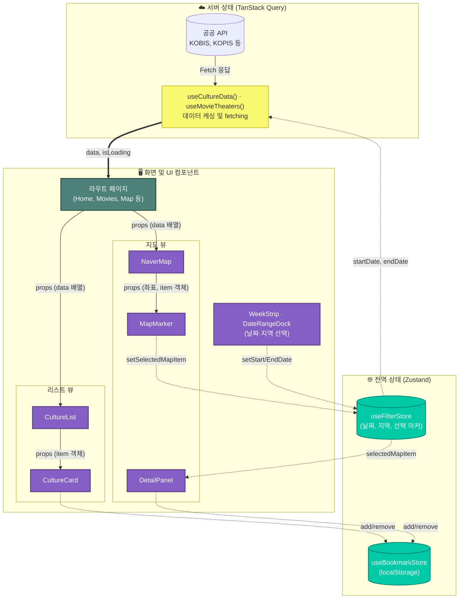

# 컬처맵 (Culture Map)

날짜와 지역을 기준으로 영화, 공연, 축제, 전시를 찾아보고 지도에서 장소를 확인하는 문화생활 탐색 서비스입니다.

- **주제:** 문화 행사 통합 검색 및 지도 탐색
- **제작 목적:** 여러 기관의 문화 정보를 한 화면에서 비교하고, 일정에 맞는 장소를 찾을 수 있도록 제작했습니다.
- **주요 사용자:** 영화·공연·축제·전시 일정을 날짜와 지역 기준으로 탐색하려는 사용자
- **개발 기간:** 2026.09.29 ~ 2026.10.01 (이후 2026.10.30까지 기능 개선)
- **배포 주소:** [https://culture-map-pi.vercel.app](https://culture-map-pi.vercel.app)
- **저장소:** [github.com/who307/culture-map](https://github.com/who307/culture-map)

## 주요 기능

| 페이지 | 기능 |
|---|---|
| `/` | 날짜 범위에 맞는 영화·콘서트·뮤지컬·지역 행사·전시 추천을 모아봅니다. |
| `/movies` | KOBIS 일일/주말 박스오피스의 순위, 관객, 매출, 상영 규모를 카드로 확인하고 네이버 상영시간표 검색이나 지도의 영화관 레이어로 이동합니다. |
| `/concerts` | KOPIS 대중음악 공연 일정, 가격, 예매처와 상세 링크를 확인합니다. |
| `/musicals` | KOPIS 뮤지컬 일정, 가격, 예매처와 상세 링크를 확인합니다. |
| `/festivals` | 한국관광콘텐츠랩 축제·행사 정보를 날짜와 지역 기준으로 탐색합니다. |
| `/exhibitions` | 문화포털 문화예술공연 API에서 전시 일정과 관람료 정보를 확인합니다. |
| `/map` | 행사 일정을 지도에서 탐색합니다. 카테고리 복수 토글과 지역 선택(서울·경기 등 9개 + 전체)으로 범위를 좁히고, 위시리스트 모드에서는 저장한 일정만 봅니다. `영화관`을 켜면 CGV·롯데시네마·메가박스·씨네Q 위치와 상영시간표 링크를 보여 주며(지도를 확대했을 때 화면 근처만 표시), 오른쪽 위 버튼으로 내 위치 주변을 볼 수 있습니다. |
| `/bookmarks` | 카드에서 저장한 문화 일정을 모아보고 위시리스트에서 제거합니다. |

가격과 예매처는 제공 API에 값이 있을 때만 표시합니다. 좌표가 없는 장소는 장소명·주소로 위치를 찾아(Photon) 보완하고, 끝내 찾지 못한 항목은 지도에 표시하지 않습니다.

## 화면 구성

### 화면 흐름 와이어프레임


홈은 주간 날짜 띠에서 날짜를 고르고 카테고리별 줄로 일정을 보여 주며, 카테고리 화면은 정렬과 페이지 이동을 제공합니다. 지도 화면은 마커를 선택하면 상세 패널을 엽니다. 화면 오른쪽(모바일은 아래쪽)의 필터 도크에서도 시작일·종료일·지역을 바꾸거나 오늘 날짜로 돌아갈 수 있습니다.

### 화면 캡처

| 홈: 주간 편성표 (라이트) | 홈 (다크) |
|---|---|
|  |  |

| 지도 탐색 | 모바일 영화 목록 |
|---|---|
|  |  |

## 디자인 시스템

극장·방송의 **주간 편성표**를 기본 틀로 삼았습니다. 홈 상단에서 한 주의 날짜 띠를 눌러 바로 날짜를 바꾸고, 카테고리는 편성표의 행처럼 왼쪽 행 제목과 오른쪽 카드로 정리합니다. 차가운 회백색 바탕에 포인트 색은 지도 파랑 하나만 두고, 카테고리는 지하철 노선색에서 가져온 색으로 구분하되, 아이콘 없이 제목 왼쪽의 색 세로선과 카드의 색 칩("콘서트" 같은 글자)으로만 표시합니다. 색과 글자를 함께 써서 색만으로 정보를 전달하지 않습니다.

| 토큰 | 라이트 | 다크 | 용도 |
|---|---|---|---|
| `paper` | `#F2F3F5` | `#0E1014` | 페이지 바탕 |
| `surface` | `#FCFCFE` | `#171A20` | 카드, 패널 |
| `ink` | `#16181D` | `#ECEEF2` | 본문 글자 |
| `accent` | `#2346D3` | `#8FA7FF` | 링크, 선택 상태, 주요 버튼 |

| 지도 핀 글자 | 카테고리 | 색 |
|---|---|---|
| 영 | 영화관 (기본은 꺼짐) | `#3A3F4B` |
| 콘 | 콘서트 | `#00843D` (지하철 2호선 계열) |
| 뮤 | 뮤지컬 | `#8B4FA8` (5호선 계열) |
| 행 | 지역 행사 | `#B35400` (3호선 계열) |
| 전 | 전시 | `#0072B0` (4호선 계열) |

- **색:** 모든 색은 [globals.css](https://github.com/who307/culture-map/blob/main/src/app/globals.css)의 `:root`와 `:root[data-theme="dark"]` 토큰으로만 정의하고, 컴포넌트는 `bg-paper`, `text-ink`, `bg-accent` 같은 토큰 클래스를 씁니다. 글자 색은 라이트·다크 모두 배경 대비 4.5:1 이상, 노선색은 흰 글자 대비 4.8:1 이상입니다.
- **주간 날짜 띠:** 홈 상단의 일주일 띠에서 날짜를 누르면 그 날로 바뀌고, 오늘·이번 주말·이 주 전체 빠른 선택과 앞뒤 주 이동을 제공합니다. 오늘은 점으로, 토·일은 색으로 구분합니다. 다른 페이지에서는 화면 오른쪽 필터 도크로 같은 날짜와 지역을 바꿉니다.
- **서체:** [Wanted Sans](https://github.com/wanteddev/wanted-sans) 한 가족(가변 400~1000)을 씁니다. 제목과 순위 숫자는 같은 서체를 굵게, 자간을 좁혀 표현하고, 숫자는 `tabular-nums`로 자릿수를 맞춥니다.
- **카테고리 정보:** 이름, 경로, 지도 핀 글자, 색은 [categories.js](https://github.com/who307/culture-map/blob/main/src/utils/categories.js) 한 곳에서 관리하며 메뉴, 홈 섹션, 카드, 지도 마커가 모두 여기서 읽습니다.
- **지도 마커:** 전국처럼 넓게 볼 때(줌 11 미만)는 14px 점으로 그려 수도권처럼 몰린 곳이 덩어리지지 않게 하고, 확대하면 노선 글자가 들어간 물방울 핀으로 바뀝니다. 선택한 마커는 1.3배로 키워 맨 위에 올립니다.
- **모션:** 빠르게 시작해 부드럽게 멈추는 커스텀 ease-out 곡선을 쓰고, 모바일 메뉴는 열 때 400ms·닫을 때 200ms로 닫기를 더 빠르게 했습니다. `transform`과 `opacity`만 움직이며, 동작 줄이기 설정에서는 이동을 끄고 짧은 페이드만 남깁니다.
- **접근성:** 본문 바로가기 링크, 모든 요소에 같은 모양의 포커스 테두리, 키보드로 조작하는 지도 범례 필터, 화면낭독기용 로딩·오류 안내, 새 창 링크 안내를 제공합니다.

## 기술 스택

- Next.js 16 App Router, React 19, JavaScript
- Tailwind CSS 4
- TanStack Query: 공공 API 서버 상태 관리, 카테고리별 캐싱, 중복 요청 제어, 로딩·에러 상태 관리
- Zustand: 날짜 범위, 지역 필터, 선택 마커, 위시리스트 상태
- `fast-xml-parser`: KOPIS XML 응답 파싱
- Naver Maps JavaScript API: 지도와 마커
- 브라우저 Geolocation API: 내 위치 보기
- KOBIS, KOPIS, 한국관광콘텐츠랩 TourAPI, 문화포털 API, 행정안전부 영화상영관 API, Photon 지오코더
- proj4: 영화상영관 TM 좌표를 위경도로 변환
- JSON Server: 로컬 개발용 데이터 서버 스크립트

## 설치 및 실행

프로젝트 디렉터리에서 실행합니다.

```bash
npm install
```

프로젝트 루트에 `.env.local`을 만들고 발급받은 키를 입력합니다. 아래 값은 예시이며 실제 키를 채팅이나 저장소에 올리지 마세요.

```dotenv
KOBIS_KEY=발급받은_KOBIS_키
KOPIS_API_KEY=발급받은_KOPIS_키
KTO_TOUR_API_KEY=발급받은_한국관광콘텐츠랩_키
CULTURE_PORTAL_API_KEY=발급받은_문화포털_키
MOVIE_THEATERS_SERVICE_KEY=발급받은_영화관_API_키
NEXT_PUBLIC_NAVER_MAP_CLIENT_ID=발급받은_Naver_Maps_클라이언트_ID
```

공공 API 키는 서버에서만 사용하므로 `NEXT_PUBLIC_` 접두사를 붙이지 않습니다. Naver 지도 SDK의 클라이언트 ID만 브라우저 SDK 로딩을 위해 공개 환경변수로 사용합니다. 지오코딩은 Photon을 사용하며 별도 키가 필요하지 않습니다. 키가 없는 API는 해당 데이터 요청이 실패하지만 개발 서버는 실행할 수 있습니다.

개발 서버를 실행합니다.

```bash
npm run dev
```

브라우저에서 [http://localhost:3000](http://localhost:3000)을 엽니다. 프로덕션 빌드는 `npm run build`, 빌드 결과 실행은 `npm start`입니다.

`db.json` 기반 JSON Server는 필요한 경우 별도 터미널에서 `npm run server`로 실행합니다. 현재 영화·공연·행사·전시 화면은 각 외부 API 라우트를 사용하며 JSON Server 실행에 의존하지 않습니다.

## 배포

[Vercel](https://vercel.com)로 배포했습니다. GitHub 저장소를 연결해 두었기 때문에 `main` 브랜치에 푸시하면 자동으로 프로덕션 배포가 진행되고, 다른 브랜치와 PR에는 미리보기 배포가 생성됩니다.

- **배포 주소:** [https://culture-map-pi.vercel.app](https://culture-map-pi.vercel.app)
- **프레임워크 설정:** Vercel이 Next.js를 자동으로 인식하므로 빌드 명령과 출력 경로는 기본값을 사용합니다.
- **환경변수:** `.env.local`은 저장소에 포함되지 않으므로, [설치 및 실행](#설치-및-실행)의 키 6개를 Vercel 프로젝트의 **Settings → Environment Variables**에 등록했습니다. 값을 바꾼 뒤에는 재배포해야 반영되며, 특히 `NEXT_PUBLIC_` 변수는 빌드 시점에 코드에 포함됩니다.
- **Naver 지도 도메인:** NCP 콘솔의 Maps 애플리케이션 **Web 서비스 URL**에 Vercel 배포 도메인을 등록해야 지도 인증이 통과됩니다.
- **JSON Server:** Vercel에서는 `npm run server`(JSON Server)가 실행되지 않습니다. 배포 환경의 모든 화면은 Next.js API 라우트로 데이터를 받습니다.

## API 연결

| 서버 경로 | 데이터 제공처 | 주요 역할 |
|---|---|---|
| `/api/box-office` | KOBIS | 일일/주말 영화 박스오피스 조회 |
| `/api/kopis` | KOPIS | 콘서트·뮤지컬 목록, 예매·공연장 상세정보 조회 |
| `/api/tour-events` | 한국관광콘텐츠랩 | `searchFestival2` 축제·행사 조회 |
| `/api/culture-exhibitions` | 문화포털 | `CNV_060`에서 `dtype=전시` · `title=전시` 교차 조건으로 전시 조회 |
| `/api/geocode` | Photon / OpenStreetMap | 좌표가 없는 장소명·주소의 좌표 검색 |
| `/api/movie-theaters` | 공공데이터포털(행정안전부) | 영업 중인 영화상영관을 극장 단위로 묶어 CGV·롯데시네마·메가박스·씨네Q만 남기고, 좌표를 위경도로 변환해 지도 영화관 레이어에 제공 |

Next.js 서버 라우트가 비밀 키를 보관하고, 외부 API 응답을 공통 문화 데이터로 변환해 화면에 전달합니다.

### 데이터가 화면까지 오는 과정

1. 사용자가 `/concerts` 화면을 열면, 화면(브라우저)이 우리 서버의 `/api/kopis`에 요청합니다.
2. 우리 서버는 `.env.local`에 숨겨둔 KOPIS 키를 붙여 KOPIS 서버에 다시 요청합니다. 키가 브라우저에 노출되지 않는 이유가 이것입니다.
3. KOPIS는 XML 형식으로 답을 줍니다. `fast-xml-parser`로 XML을 자바스크립트 객체로 바꿉니다.
4. 기관마다 필드 이름이 다르므로(`prfnm`, `title` 등) 우리 앱에서 쓰는 공통 모양(제목·기간·장소·가격·이미지)으로 바꿉니다(정규화).
5. 화면은 TanStack Query로 이 결과를 받아 캐시에 보관하고, `CultureCard`로 그립니다.

### 용어 쉽게 보기

| 용어 | 쉬운 설명 |
| :--- | :--- |
| API | 다른 기관의 서버에 "데이터 좀 줘"라고 요청하는 창구 (식당 주문 창구) |
| API 키 | 그 창구를 이용할 수 있는 회원증. 남이 보면 안 되므로 서버에만 보관 |
| 좌표 | 지도에서 위치를 나타내는 두 숫자(위도·경도) |
| 지오코딩 | "서울 예술의전당" 같은 장소 이름·주소를 좌표로 바꾸는 일 (Photon이 담당) |
| TM 좌표 | 위경도가 아닌, 미터 단위 평면 좌표계. 영화상영관 API가 이 형식이라 `proj4`로 위경도로 바꿈 |
| 정규화 | 기관마다 다른 데이터 모양을 하나의 같은 모양으로 맞추는 일 |
| `persist` | Zustand 상태를 브라우저 저장소(`localStorage`)에 자동 저장해 새로고침해도 남게 하는 기능 |
| 하이드레이션 | 서버가 만든 HTML에 브라우저 React가 이벤트를 연결하는 과정. 서버(빌드)와 브라우저의 결과가 다르면 불일치가 생김 (트러블슈팅 5번) |

## 폴더 구조

```text
docs/                    # README 화면 캡처
src/
├── app/                 # 페이지, 라우팅, API 서버 라우트
│   ├── api/             # KOBIS, KOPIS, 관광, 문화포털, 영화상영관, 지오코딩 API
│   ├── bookmarks/       # 위시리스트 페이지
│   ├── map/             # 지도 탐색 페이지
│   └── ...              # 홈 및 카테고리 페이지
├── components/
│   ├── common/          # 헤더, 네비게이션, 날짜 도크, 공통 UI
│   ├── culture/         # 문화 카드, 목록, 정렬, 카테고리 페이지
│   └── map/             # 지도, 마커, 상세 패널
├── hooks/               # 문화·영화관 데이터, Naver 지도, 클라이언트 렌더링 확인 훅
├── store/               # Zustand 필터 및 위시리스트 상태
└── utils/               # API 연결, 카테고리·지역 상수, 좌표 확인, 날짜, 표시 포맷
```

## 컴포넌트와 상태 관리

| 항목 | 역할 |
|---|---|
| `CultureCard`, `CultureList` | 가격·일정·이미지·예매 또는 상세 링크를 카드로 표시합니다. 영화는 포스터 대신 순위·제목·매출 점유율 커버를 쓰고, 정보 영역은 다른 카드와 같은 구조(요약 줄 → 링크 줄 → 하단 날짜·강조 값)로 표시합니다. |
| `WeekStrip` | 홈 상단의 주간 날짜 띠입니다. 날짜·빠른 기간 선택으로 필터 상태의 시작일과 종료일을 바꿉니다. |
| `CultureCategoryPage` | 카테고리 데이터와 정렬, 페이지네이션을 관리합니다. |
| `DateRangeDock` | 화면 오른쪽(모바일은 아래쪽)에서 날짜 범위와 지역을 바꿉니다. |
| `NaverMapContainer`, `MapMarker` | 카테고리 복수 토글 필터링, 좌표 없는 항목의 위치 검색(Photon), 줌에 따라 점과 핀으로 바뀌는 마커를 처리합니다. 영화관은 직접 켰을 때 확대된 화면 근처만 그리고, 내 위치 버튼으로 현재 위치를 표시합니다. |
| `DetailPanel` | 선택한 마커의 일정, 장소, 가격, 상세 링크를 보여줍니다. 영화관은 상영관 수, 주소, 전화번호, 상영시간표 링크를 보여줍니다. |

- 날짜 범위, 지역, 선택 마커는 Zustand로 여러 화면에서 공유합니다.
- 위시리스트는 항목 ID와 카드 정보를 Zustand `persist`로 `localStorage`에 저장합니다.
- API 데이터는 TanStack Query가 요청·캐시·오류 상태를 관리합니다.
- 정렬, 페이지, 지도 표시 모드는 각 화면의 로컬 상태로 관리합니다.

### 상태 데이터 흐름도



## 트러블슈팅

서비스의 핵심인 **공공 데이터 연동**과 **지도 표시**에서 겪은 문제를 **원인 → 해결 → 결과** 순서로 정리했습니다.

### 1. 좌표가 없는 공연·전시가 지도에 안 보임

- **원인:** KOPIS 목록과 일부 문화포털 전시 데이터에 위도·경도가 없습니다.
- **해결:** KOPIS는 공연장 상세 정보에서 좌표를 추가로 가져오고, 나머지는 장소명·주소로 위치를 검색(Photon)합니다. 검색 결과가 한국 밖이면 버립니다.
- **결과:** 좌표가 없던 공연·전시도 지도에 표시되고, 엉뚱한 위치에 마커가 찍히지 않습니다.

### 2. 영화마다 상영 중인 영화관을 보여줄 수 없음

- **원인:** 공공 API에는 극장별 상영 정보가 없습니다. KOBIS는 전국 스크린 수만, 영화상영관 API는 극장 시설 정보만 주고, 멀티플렉스 시간표는 공개 API가 없습니다.
- **해결:** 지도에 영화관 위치를 보여 주고, 극장마다 네이버 상영시간표 검색으로 연결했습니다.
- **결과:** 영화 카드 → 영화관 지도 → 극장별 상영시간표로 이어지는 흐름을 만들었습니다.

### 3. 영화관 데이터를 그대로 쓸 수 없음

- **원인:** 한 번에 100건까지만 내려오고, 상영관(1관·2관…)마다 따로 등록돼 있으며, 좌표도 위경도가 아닌 다른 좌표계(TM)입니다.
- **해결:** 영업 중인 곳만 페이지를 나눠 모두 받고, 같은 건물의 상영관을 한 극장으로 묶은 뒤 `proj4`로 위경도로 바꿨습니다.
- **결과:** 상영관 단위 3,504건을 극장 단위로 정리해, CGV·롯데시네마·메가박스·씨네Q 450곳을 지도에 표시합니다.

### 4. 영화관 마커가 많아 지도가 느려짐

- **원인:** 영화관을 켜면 마커 688개를 한 번에 그렸습니다.
- **해결:** 지도를 충분히 확대(줌 13 이상)했을 때 화면 근처 영화관만 그리고, 축소 상태에서는 확대 안내와 내 위치 버튼을 보여 줍니다.
- **결과:** 한 화면에 그리는 영화관 마커가 강남역 주변 기준 약 13개로 줄었습니다.

### 5. 배포 사이트에 하루 전 날짜가 보임

- **원인:** 페이지를 빌드할 때 그날 날짜가 HTML에 그대로 들어갔습니다.
- **해결:** 오늘 날짜에 따라 바뀌는 부분은 브라우저에서만 그리도록 바꿨습니다(`useIsClient`).
- **결과:** 방문한 날의 날짜와 일정이 정확히 표시됩니다.

## 프로젝트 회고

기관마다 다른 응답 형식과 필드 이름을 공통 문화 데이터로 정리하면서 API 응답 정규화와 오류 처리가 중요하다는 점을 배웠습니다. 앞으로는 자동화된 API·지도 상호작용 테스트를 보완하고, 장소 검색 결과의 정확도를 더 높이고 싶습니다.

