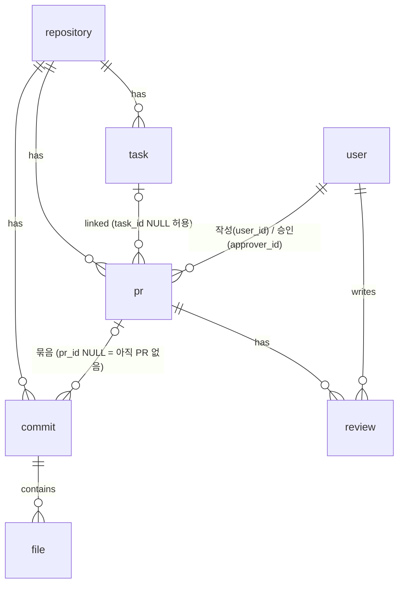

# 포켓헙 기획 정리 (26.11.02 ~ 26.11.11)

> 팀 노션의 기획 문서(프로젝트 개요서·유사 서비스 분석·정책정의서·요구사항 정의서·사용자 시나리오·화면 설계서·API 명세서)를 바탕으로, 개발에 들어가기 전에 정한 내용을 정리함. 실제 개발은 **11/12부터** 시작
>
> ⭐ 표시는 내 담당 도메인(PR·리뷰)

## 0. 기획 흐름

| 날짜 | 내용 |
| :--- | :--- |
| `11.02 (월)` | 첫 회의. 주제 선정, 팀장·DB·Git·문서·UI/발표 공통 역할 분담 |
| `11.03 (화)` | 두 번째 회의. 요구사항 정의서 v1.0 작성 |
| `11.04 (수) ~ 11.06 (금)` | 회의 3~5. 정책정의서·사용자 시나리오·사용자 흐름도·화면 설계서·ERD |
| `11.11 (수)` | 회의 6. API 명세서·도메인별 담당 정리, GitHub 저장소 생성·백엔드 초기 세팅·프론트 목업 |
| `11.12 (목) ~` | **개발 시작** |

* 회의는 날짜별 회의록으로 남기고, 결정되지 않은 내용은 "논의 필요"로 표시함
* 정확한 작성일이 있는 문서는 요구사항 정의서(11/03)뿐이라, 나머지 문서는 회의 일정 기준으로 묶음
* 이슈는 노션보다 **GitHub Issues**로 관리하기로 함

---

## 1. 프로젝트 개요

**포켓헙(PocketHub)**: Git 같은 파일 관리 시스템과 일정(Task) 관리 시스템을 합친 협업 서비스

| 항목 | 내용 |
| :--- | :--- |
| 기획 배경 | 코드는 GitHub, 작업은 Trello·Jira로 따로 관리해서 작업 현황과 코드 변경 내역을 함께 보기 번거로움 |
| 목표 | 코드(파일) 관리와 Task 관리를 한 플랫폼에서. Git 명령어 없이 한글 GUI로 |
| 주요 사용자 | 협업·일정 관리가 필요한 사용자, 문서·프로그램을 공유하려는 사용자, 영어가 익숙하지 않은 사용자 |
| 개발 인원·기간 | 5명, 개발 7일 (요구사항 정의서 기준) |

### 유사 서비스 분석

| 서비스 | 주요 기능 | 한계 → 우리 서비스에 반영 |
| :--- | :--- | :--- |
| GitHub | 저장소·파일·커밋 기록·브랜치·Pull Request | 사용하기 어렵고 영어만 지원 → **한글 GUI, Git 개념을 단순화** |
| Trello | 보드·작업 카드·체크리스트·담당자·진행 상태 | 단독으로는 Task 관리만 가능, 코드와 연결하려면 외부 연동 필요 → **Task와 PR·Commit을 직접 연결** |

### 핵심 개념: GitHub를 단순하게 옮기기

```text
팀(Repository) ─┬─ 파일 업로드/삭제 ──→ Commit (메시지 + 파일 목록)
                ├─ Task (TODO → DOING → DONE, 담당자·마감일·우선순위)
                └─ PR (Commit 여러 개 + Task 1개를 묶어 리뷰 요청)
                     ├─ 리뷰 작성
                     └─ 승인 → 연결된 Task 자동 DONE / 거부 → 연결된 Commit 삭제
```

* 브랜치는 없음. 파일을 올리거나 지울 때마다 Commit이 생기고, **PR에 연결되지 않은 Commit**들을 골라 PR로 묶음
* 파일 삭제는 실제로 지우지 않고 "삭제됐다"는 Commit을 남김 (NFR-009)

---

## 2. 요구사항 정의서 (v1.0, 11/03)

### 도메인별 기능

| 도메인 | 요구사항 ID | 주요 기능 |
| :--- | :--- | :--- |
| 회원 | AUTH-001~004 | 회원가입(이메일·비밀번호·닉네임), 로그인, 로그아웃, 내 정보 조회 |
| 팀 | TEAM-001~005 | 팀 생성, 내 팀 목록, 팀 상세, 팀원 추가·삭제, 팀 정보 수정(Could) |
| 파일 | FILE-001~006 | 업로드, 목록, 상세, 다운로드, 삭제, 팀원만 접근 |
| Commit | COMMIT-001~004 | 업로드·삭제 시 Commit 생성, 목록, 상세(포함 파일), PR과 연결 |
| Task | TASK-001~010 | 생성·조회·수정·삭제, 상태 변경, 담당자, 마감일, Task별 PR 조회, 우선순위 |
| 파일-Commit | LINK-001~002 | Commit에 포함된 파일 조회·다운로드 |
| ⭐ PR | PR-001~006 | 아래 표 |
| ⭐ 리뷰 | REV-001~004 | 아래 표 |
| 연동·자동화 | AUTO-001~006 | Task-PR·PR-Commit·Commit-File 연결, 승인 시 상태 반영·Task 자동 완료 |

### ⭐ 내 담당: PR·리뷰 요구사항

| ID | 기능 | 내용 | 우선순위 |
| :--- | :--- | :--- | :--- |
| PR-001 | PR 생성 | 생성한 Commit 기반으로 PR 생성 | Must |
| PR-002 | PR 정보 입력 | 제목·상세 설명 입력 | Must |
| PR-003 | PR 목록 조회 | 생성된 PR 목록 확인 | Must |
| PR-004 | PR 상세 조회 | 설명·작성자·연결된 Task·파일·리뷰 내역 | Must |
| PR-005 | PR 상태 관리 | 진행 상태(생성·리뷰 대기·승인·종료 등) 관리 | Must |
| PR-006 | PR 승인 / 거부 | 리뷰어가 PR을 확인하고 승인·거부 | Must |
| REV-001 | 리뷰 작성 | PR에 리뷰 의견 작성 | Must |
| REV-002 | 리뷰 조회 | PR의 리뷰 내역 확인 | Must |
| REV-003 | 리뷰 수정 | 작성자 본인만 | Could |
| REV-004 | 리뷰 삭제 | 작성자 본인만 | Could |
| AUTO-001 | Task-PR 연동 | PR 생성 시 Task와 연결 | Must |
| AUTO-002 | PR-리뷰 연동 | PR 상세에서 리뷰 작성·조회 | Must |
| AUTO-003 | 승인 상태 반영 | 승인되면 PR 상태 변경 | Must |
| AUTO-004 | Task 완료 연동 | 승인되면 연결된 Task 자동 완료 | Should |
| AUTO-005 | PR-Commit 연동 | PR 생성 시 Commit과 연결 | Must |

### 비기능 요구사항 (주요)

| ID | 구분 | 내용 |
| :--- | :--- | :--- |
| NFR-001·002 | 사용성·언어 | Git 명령어 없이 GUI로, 메뉴·버튼·오류 메시지는 한국어 |
| NFR-004 | 보안 | 비밀번호 암호화 저장, 권한 검증 |
| NFR-005·006 | 무결성·일관성 | Task·파일·PR·리뷰 연관 데이터 유지, **PR 승인과 Task 상태 변경이 서로 일치** |
| NFR-008 | 파일 보안 | 확장자·크기 검증, 권한 없는 접근 차단 |
| NFR-009 | 파일 삭제 | 실제 삭제가 아니라 Commit에 삭제 기록 |
| NFR-012 | 오류 처리 | 실패 원인을 알 수 있는 안내 메시지 |
| NFR-014 | Commit 삭제 | PR이 거부되면 해당 Commit 삭제 (Should) |

* 우선순위: **Must**(핵심, 반드시) · **Should**(가능하면) · **Could**(시간 남으면) · **Won't**(이번 범위 제외)

---

## 3. 정책정의서 (11/04)

### 권한

| 기능 | 비로그인 | 회원(팀 외부) | 팀원 | 팀 관리자(OWNER) |
| :--- | :---: | :---: | :---: | :---: |
| 팀 생성 | ✕ | ○ | ○ | ○ |
| 팀원 초대·팀 삭제 | ✕ | ✕ | ✕ | ○ |
| 파일 업로드·다운로드·삭제 | ✕ | ✕ | ○ | ○ |
| Task 생성·상태 변경 | ✕ | ✕ | ○ | ○ |
| ⭐ PR 생성, PR과 Task·Commit 연결 | ✕ | ✕ | ○ | ○ |
| ⭐ PR 승인 | ✕ | ✕ | 본인 PR 제외 | 본인 PR 제외 |
| ⭐ 리뷰 작성 | ✕ | ✕ | ○ | ○ |

* 팀원·관리자는 **본인이 속한 팀의 데이터에만** 권한이 있음. 팀 권한은 `OWNER`(팀 생성자)·`MEMBER`

### ⭐ PR 정책

| 항목 | 정책 |
| :--- | :--- |
| 생성 | 팀원이면 생성 가능. **제목과 Commit은 필수** |
| 작성자 | PR을 만든 사용자. 제목·설명 수정은 작성자만 |
| 상태 | `OPEN` → `APPROVED` / `CLOSED` |
| 승인 | **작성자를 제외한** 팀원이 승인 |
| 삭제 | 작성자 또는 팀 관리자 |
| Commit 연결 | 생성 시 **아직 PR에 연결되지 않은** Commit 여러 개를 연결. 같은 팀의 Commit만, 중복 연결 불가 |
| 승인 시 | 연결된 Commit은 영구 저장, 연결된 Task는 자동 완료 |
| 거부 시 | 연결된 Commit 완전 삭제 (Commit 삭제 시 연결된 파일도 삭제) |
| PR 삭제 시 | Commit과의 연결만 끊고 Commit 자체는 남김 |
| Task 연결 | 같은 팀의 Task만, 중복 연결 불가. Task를 지우면 연결만 삭제하고 PR은 유지 |

### ⭐ 리뷰 정책

| 항목 | 정책 |
| :--- | :--- |
| 작성 | 팀원이면 누구나. **내용 필수** |
| 수정·삭제 | 작성자 본인만 |
| 표시 | 작성자 표시 |
| 승인과의 관계 | 리뷰 작성과 PR 승인은 **별개 기능** (리뷰 없이도 승인 가능, 리뷰가 승인을 의미하지 않음) |
| 완료된 PR | 새 리뷰 작성 불가, 기존 리뷰 조회만 가능 |

### 예외 메시지 (PR·리뷰 관련)

| 상황 | 처리 | 메시지 |
| :--- | :--- | :--- |
| 비로그인 접근 | 인증 실패 | 로그인이 필요합니다. |
| 다른 팀 접근 | 권한 실패 | 해당 팀에 접근할 권한이 없습니다. |
| 없는 PR | 요청 실패 | PR을 찾을 수 없습니다. |
| 본인 PR 승인 | 권한 실패 | 본인이 작성한 PR은 승인할 수 없습니다. |
| 종료된 PR 승인 | 요청 실패 | 종료된 PR은 승인할 수 없습니다. |
| 빈 리뷰 | 입력값 검증 실패 | 리뷰 내용을 입력해주세요. |

* 목록 조회는 기본 최신순, PR 목록은 상태로 필터링

---

## 4. 사용자 시나리오 (⭐ PR·리뷰)

시나리오는 총 13개 (회원가입·로그인 → 팀 → 파일·Commit → Task → PR). 내 담당은 11~13번.

### 시나리오 11. Commit과 Task를 연결해 PR 생성

1. 팀 상세 → PR 화면 → **새 PR** 버튼
2. 모달에서 제목·설명 입력, 포함할 **Commit 선택**, 연결할 **Task 선택**
3. **PR 만들기** → 대기(OPEN) 상태로 생성되고 PR 상세가 열림
4. PR 목록과 태스크 보드의 Task 상세에서 연결된 PR 확인

* 예외: 제목 누락, "Commit을 선택해 주세요.", "연결할 Task를 선택해 주세요.", 없는 Commit·Task, 팀원 아님

### 시나리오 12. 리뷰를 남기고 승인

1. PR 목록에서 대기 중인 PR 선택
2. 상세에서 설명·작성자·연결된 Task·Commit과 파일·기존 리뷰 확인 (필요하면 파일 다운로드)
3. 리뷰 작성·등록
4. **승인** → PR 상태 승인, **연결된 Task 자동 DONE**

* 예외: 빈 리뷰, "이미 승인된 PR입니다.", 작성자 본인은 승인 불가

### 시나리오 13. PR 거부

1. PR 상세에서 내용 확인 → 거부 사유를 리뷰로 작성 → **거부**
2. 연결된 Task는 완료되지 않고 그대로 유지

* 예외: "이미 처리된 PR입니다."

---

## 5. 화면 설계서

| 화면 | URL | 주요 기능 |
| :--- | :--- | :--- |
| 메인 | `/` | 서비스 소개 |
| 로그인/회원가입 | `/auth` | 탭 전환 |
| 팀 목록 | `/teams` | 내 팀 목록, 팀 생성 |
| 팀 상세 | `/teams/:teamId` | 팀 정보, 팀원 추가·삭제 |
| 파일·커밋 | `/teams/:teamId/files` | 파일 업로드·다운로드, Commit 이력 |
| 태스크 보드 | `/teams/:teamId/tasks` | Task 칸반, 상태·담당자·일정 |
| ⭐ PR | `/teams/:teamId/pulls` | PR 생성·리뷰, 승인·거부 |

* 모달·탭·패널은 별도 화면이 아니라 해당 화면 안의 단계로 봄 (PR 생성 모달, PR 상세 패널 등)

---

## 6. API 명세서 (11/11)

공통 규칙: `/api/v1` 접두사, 리소스(명사) 중심 URL, 조회 GET·등록 POST·일부 수정 PATCH·삭제 DELETE, 인증이 필요한 API는 `Authorization` 헤더

| 담당 | API | 범위 |
| :--- | :--- | :--- |
| 1 | API-001~004 | 회원·인증 (`/members`, `/auth/login`, `/auth/logout`) |
| 2 | API-005~012 | 팀·팀원 (`/teams`, `/teams/{teamId}/members`) |
| 3 | API-013~021 | 파일·Commit (`/teams/{teamId}/files`, `/commits`) |
| 4 | API-022~028 | Task (`/teams/{teamId}/tasks`) |
| ⭐ 5 (나) | API-029~037 | PR·리뷰 |

### ⭐ 내 담당 API

| ID | Method | URL | 기능 |
| :--- | :--- | :--- | :--- |
| API-029 | POST | `/api/v1/teams/{teamId}/pulls` | PR 생성 |
| API-030 | GET | `/api/v1/teams/{teamId}/pulls` | PR 목록 조회 |
| API-031 | GET | `/api/v1/teams/{teamId}/pulls/{prId}` | PR 상세 조회 |
| API-032 | POST | `/api/v1/teams/{teamId}/pulls/{prId}/approve` | PR 승인 |
| API-033 | POST | `/api/v1/teams/{teamId}/pulls/{prId}/reject` | PR 거부 |
| API-034 | POST | `/api/v1/teams/{teamId}/pulls/{prId}/reviews` | 리뷰 작성 |
| API-035 | GET | `/api/v1/teams/{teamId}/pulls/{prId}/reviews` | 리뷰 목록 조회 |
| API-036 | PATCH | `/api/v1/teams/{teamId}/pulls/{prId}/reviews/{reviewId}` | 리뷰 수정 |
| API-037 | DELETE | `/api/v1/teams/{teamId}/pulls/{prId}/reviews/{reviewId}` | 리뷰 삭제 |

* 승인·거부는 상태를 바꾸는 "동작"이라 `PATCH /pulls/{prId}` 대신 `POST .../approve`, `.../reject`처럼 동사형 하위 경로로 둠
* Task 쪽 `GET /tasks/{taskId}/pulls`(Task별 PR 조회, API-028)도 PR 데이터를 쓰므로 Task 담당과 응답 형태를 맞춰야 함

---

## 7. ERD (`backend/db/schema.sql`)

테이블 9개: `user`, `repository`(팀), `collaborator`(팀원), `task`, `pr`, `commit`, `file`, `review`, `refresh_token`



### ⭐ PR·리뷰 테이블

| 테이블 | 주요 컬럼 | 비고 |
| :--- | :--- | :--- |
| `pr` | `title`, `text`, `state`(기본 `OPEN`), `task_id`, `user_id`(작성자), `approver_id`(승인/거부자), `end_at`(승인/거부 시각), `reply` | `task` 삭제 시 `task_id` → NULL, 팀 삭제 시 CASCADE |
| `commit` | `pr_id` (NULL 허용) | **`pr_id`가 NULL인 Commit = PR에 넣을 수 있는 Commit**. PR 삭제 시 NULL로 |
| `review` | `comment`(필수), `user_id`, `pr_id` | PR 삭제 시 리뷰도 CASCADE 삭제 |

* PR과 Commit은 별도 연결 테이블 없이 `commit.pr_id`로 1:N 연결 → "PR에 연결되지 않은 Commit만 연결"·"중복 연결 불가" 정책이 컬럼 하나로 표현됨

---

## ⚠️ 개발 전에 팀과 맞춰야 할 것

문서마다 상태 값이 달라서, PR·Task 상태를 enum으로 만들기 전에 확정이 필요함.

| 대상 | 요구사항 정의서 | 정책정의서 | `schema.sql` 주석 |
| :--- | :--- | :--- | :--- |
| PR 상태 | 생성·리뷰 대기·승인·종료 | `OPEN`, `APPROVED`, `CLOSED` | `OPEN`, `APPROVE`, `DENIED` |
| Task 상태 | - | `TODO`, `IN_PROGRESS`, `DONE` | `TODO`, `DOING`, `DONE` |

* 거부를 `CLOSED`로 볼지 `DENIED`로 따로 둘지에 따라 "종료된 PR은 승인할 수 없습니다" 같은 검사 조건이 달라짐
* 정책의 "PR 삭제"(작성자·관리자)와 "리뷰 수정·삭제"(Could)는 API 명세에 PR 삭제가 없음 → 범위 확인 필요
* 노션 개발 환경 문서(Spring Boot 4.x, jjwt)와 실제 저장소(Spring Boot 3.5, JWT 라이브러리 아직 없음)도 다름

---

## 느낀 점

* 기능 목록만 있을 때는 단순해 보였는데, 정책을 정하다 보니 "본인 PR은 승인 불가", "거부되면 Commit 삭제", "완료된 PR엔 리뷰 불가"처럼 **경계 상황**이 계속 나왔음. 이걸 코드보다 먼저 문서로 정한 게 개발할 때 기준이 될 것 같음
* 내 담당인 PR은 Commit·Task·리뷰와 모두 연결되는 기능이라, 다른 도메인 담당자와 응답 형태·상태 값을 먼저 맞춰야 한다는 걸 느낌
* GitHub의 PR을 직접 만들어 보면서 평소에 쓰던 기능이 어떤 데이터 관계로 이루어져 있는지 다시 보게 됨
